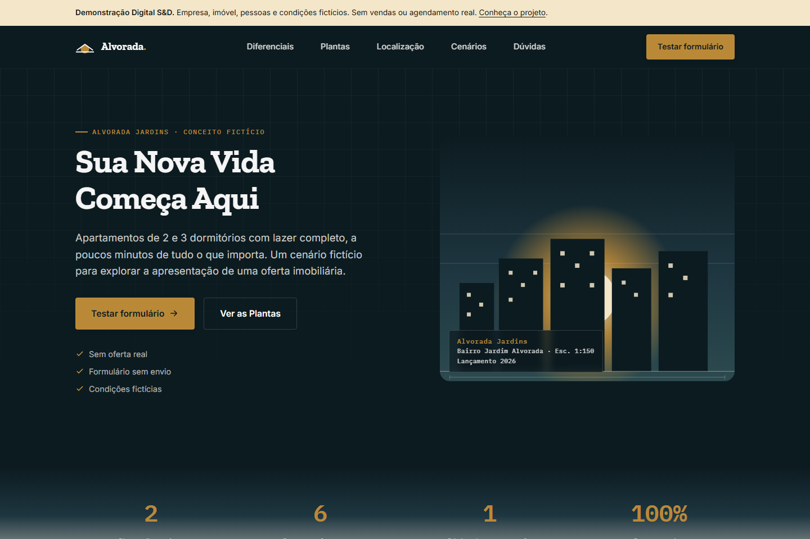

# Alvorada — Digital S&D demo

[Português](README.md) · [Live demo](https://digital-s-d.github.io/Construtora-Alvorada_LandingPage/) · [Portfolio case](https://digitalsd.com.br/portfolio/alvorada/) · [Project enquiries](mailto:digitalsd.contato@gmail.com)

## Purpose and scope

A fictional property landing page exploring a focused offer, two apartment layouts and an enquiry journey. This is a team-built portfolio concept, not a client commission or a real property offer. The company, people, location, dimensions and prices are fictional. No bookings, sales or financing are provided.

## Screenshots

[Mobile](docs/capturas/mobile.png) · [Demo form](docs/capturas/formulario.png). These are screenshots of the running implementation.

## Run

Run `python -m http.server 8000 --bind 127.0.0.1`, then open `http://127.0.0.1:8000`. No build is needed. `index.html`, `privacidade.html`, `termos.html` and `cookies.html` share `styles.css` and `script.js`. Google Fonts is an external font resource with local fallbacks.

## Features and limits

Responsive layout, apartment comparison, keyboard-operable FAQ, mobile navigation and a form with inline validation. The form accepts fictional examples, sends nothing and clears the fields on completion. With JavaScript disabled, fields stay disabled and the form uses the dialog method. Phone checks validate format only. There is no backend, CRM, connected email, WhatsApp, video tour or real booking.

Only demo preference settings are stored in localStorage. No analytics or advertising services are connected; navigation events stay in the local dataLayer without form values. Hosting and font requests can still generate technical logs. All demo pages are marked `noindex, nofollow`.

## Team and verification

Built by the Digital S&D team, founded by Álvaro Marinho and Arthur Leite. Individual ownership of the entire implementation is not claimed. This revision clarifies the demo, corrects form and navigation behaviour and documents the implementation.

For tests, use Node.js 24: `npm ci`, `npx playwright install chromium`, `npm run check`. Five browser tests cover local links, demo notices, form validation and clearing without transmission, keyboard FAQ, JavaScript-disabled behaviour and desktop/mobile navigation. Test screenshots go to `test-results/`; set `CAPTURE_DEMO=1` to update the documentation screenshots.

A real deployment requires authorised content, genuine contact channels, confirmed delivery of enquiries and integrations appropriate to the agreed scope. No sales or conversion results are claimed.
