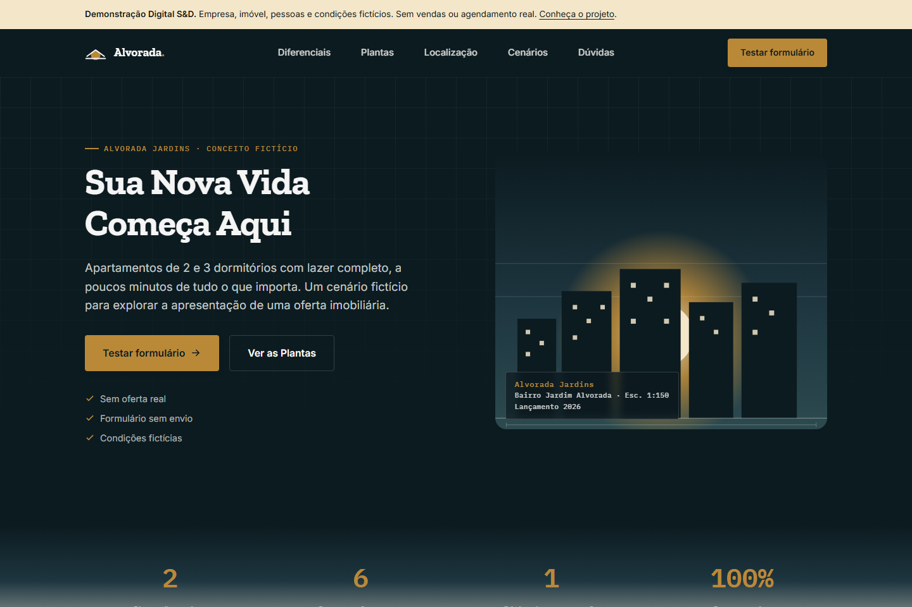

# Alvorada — demonstração Digital S&D

[English](README.en.md) · [Demonstração](https://digital-s-d.github.io/Construtora-Alvorada_LandingPage/) · [Caso de portfólio](https://digitalsd.com.br/portfolio/alvorada/) · [Orçamento com a SD](mailto:digitalsd.contato@gmail.com)

## Propósito e natureza

Landing page imobiliária fictícia para apresentar uma oferta específica, comparar duas plantas e experimentar uma jornada de interesse. Não é um empreendimento real ou projeto de cliente. Empresa, pessoas, mapa, metragens e valores são fictícios; não há reserva, venda, financiamento ou agendamento de visita.

## Capturas reais



[Versão mobile](docs/capturas/mobile.png) · [Formulário demonstrativo](docs/capturas/formulario.png). Capturas geradas a partir desta versão em execução; não são mockups.

## Execução

O site não precisa de build nem de pacotes. São quatro páginas HTML (`index.html`, `privacidade.html`, `termos.html`, `cookies.html`), com estilos em `styles.css` e comportamento em `script.js`.

```sh
python -m http.server 8000 --bind 127.0.0.1
# Abra http://127.0.0.1:8000
```

HTML, CSS e JavaScript puro. Google Fonts fornece Zilla Slab, Inter e IBM Plex Mono, com fallback local. Cores e espaçamentos ficam em `:root` de `styles.css`.

## Funcionalidades

- Layout responsivo, navegação mobile com Escape e fechamento por link.
- Duas plantas e comparação de suas características fictícias.
- FAQ com estado acessível e acionamento por teclado.
- Máscara e validação de telefone brasileiro, campos obrigatórios e confirmação do caráter demonstrativo. Validar formato não comprova titularidade ou existência do número.
- Conclusão explícita de teste, limpeza dos campos e opção de repetir.
- Painel demonstrativo de preferências, lembrado localmente.

## Limitações e dados

O formulário não tem backend, CRM, e-mail ou WhatsApp. Valida valores no navegador e os apaga ao concluir, sem gravá-los no localStorage, nos eventos ou em URLs. Use apenas dados fictícios. Sem JavaScript, o fieldset permanece desabilitado e `method="dialog"` impede submissão HTTP acidental.

Não há tour ou vídeo: a área visual é uma ilustração estática. Os antigos depoimentos e comparativos de mercado foram substituídos por cenários de uso e comparação das duas plantas. Não há resultados de clientes ou promessas de retorno de consultor.

O localStorage guarda apenas `alvoradaCookieConsent`; escolhas de analytics e marketing são uma prévia de interface, sem serviços conectados. Eventos de navegação permanecem no `window.dataLayer`, sem valores digitados e sem envio por esta aplicação. Google Fonts e a hospedagem podem receber requisições técnicas. Todas as páginas usam `noindex, nofollow`; o caso da SD é separado.

Uma implantação real exige conteúdo autorizado, contatos reais, envio com recebimento comprovado, integrações e revisão dos documentos conforme o tratamento efetivo de dados.

## Participação

Projeto da equipe Digital S&D. Álvaro Marinho e Arthur Leite são fundadores da SD; este repositório não atribui toda a implementação a uma única pessoa. A revisão desta versão corrigiu transparência da demonstração, validação, estados de navegação e documentação.

## Verificação reproduzível

Node.js 24 e npm são necessários somente para os testes:

```sh
npm ci
npx playwright install chromium
npm run check
```

Cinco testes de navegador cobrem links e avisos das quatro páginas, validação e limpeza sem envio, FAQ por teclado, bloqueio sem JavaScript, menu e ausência de transbordamento horizontal em 1440 e 390 px. As capturas dos testes ficam em `test-results/`; use `CAPTURE_DEMO=1` no ambiente para atualizar `docs/capturas/` ao revisar a apresentação.
